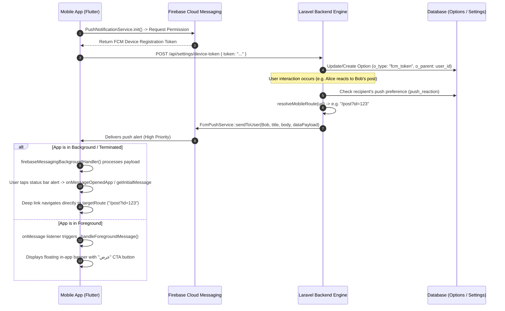

# Firebase Push Notifications (FCM)

Push notifications keep members engaged across devices by delivering instant alerts for post likes, comments, mentions, private messages, follower updates, and system announcements.

---

## 1. End-to-End Architecture



---

## 2. Backend Push Dispatcher (`FcmPushService`)

Located in `app/Services/FcmPushService.php`, this service supports both modern **Google FCM HTTP v1 (OAuth2 JWT)** and **Legacy Server Key** protocols with automatic graceful fallback:

### 2.1 FCM HTTP v1 Implementation (Recommended)
FCM HTTP v1 uses OAuth2 access tokens signed with a Google Service Account private key via `firebase/php-jwt`:

```php
// app/Services/FcmPushService.php
protected function sendViaHttpV1(string $token, string $title, string $body, array $data, string $credentialsPath, ?string $projectId): bool
{
    $json = json_decode(file_get_contents($credentialsPath), true);
    $accessToken = $this->getGoogleAccessToken($json);

    $url = "https://fcm.googleapis.com/v1/projects/{$projectId}/messages:send";

    $payload = [
        'message' => [
            'token' => $token,
            'notification' => [
                'title' => $title,
                'body' => $body,
            ],
            'data' => array_merge([
                'click_action' => 'FLUTTER_NOTIFICATION_CLICK',
                'title' => $title,
                'body' => $body,
            ], $stringData),
            'android' => [
                'priority' => 'high',
                'notification' => [
                    'sound' => 'default',
                    'default_sound' => true,
                    'channel_id' => 'myads_general',
                ],
            ],
        ],
    ];

    $response = Http::withToken($accessToken)->post($url, $payload);
    return $response->successful();
}
```

### 2.2 Deep-Link Route Resolution
The backend transforms web URLs into clean Flutter GoRouter paths inside `NotificationService::resolveMobileRoute()`:

| Source Web URL | Resolved Flutter In-App Route | Destination Screen |
| :--- | :--- | :--- |
| `/clips/208` | `/clips/208` | `ClipsScreen(initialClipId: 208)` |
| `/t261` or `/post/261` | `/post?id=261` | `PostDetailsScreen(statusId: 261)` |
| `/messages/mrghozzi` | `/messages/mrghozzi` | `ChatScreen(username: 'mrghozzi')` |
| `/profile/alice` | `/user-profile?username=alice` | `ProfileScreen(username: 'alice')` |
| `/orders/5` | `/orders/5` | `OrderDetailScreen(orderId: 5)` |
| `/history` | `/settings/history` | `HistorySettingsScreen()` |

---

## 3. Flutter Client Service (`PushNotificationService`)

Located in `lib/core/services/push_notification_service.dart`, the client service is initialized during application bootstrap in `main.dart`.

### 3.1 Background Message Handler
Android requires a top-level `@pragma('vm:entry-point')` function executed in an isolated Dart context when incoming pushes arrive while the app is closed:

```dart
@pragma('vm:entry-point')
Future<void> firebaseMessagingBackgroundHandler(RemoteMessage message) async {
  try {
    await Firebase.initializeApp();
  } catch (_) {}
  if (kDebugMode) {
    print('Handling background push notification: ${message.messageId}');
  }
}
```

### 3.2 Service Initialization & Token Sync
```dart
class PushNotificationService {
  final FirebaseMessaging _fcm = FirebaseMessaging.instance;

  Future<void> init() async {
    // 1. Register top-level background handler
    FirebaseMessaging.onBackgroundMessage(firebaseMessagingBackgroundHandler);

    // 2. Request permission (iOS & Android 13+ POST_NOTIFICATIONS)
    NotificationSettings settings = await _fcm.requestPermission(
      alert: true,
      badge: true,
      sound: true,
    );

    if (settings.authorizationStatus == AuthorizationStatus.authorized) {
      // 3. Configure foreground presentation options
      await _fcm.setForegroundNotificationPresentationOptions(
        alert: true,
        badge: true,
        sound: true,
      );

      // 4. Retrieve FCM device token and register with server
      String? token = await _fcm.getToken();
      if (token != null) {
        await _registerTokenWithServer(token);
      }

      // 5. Token refresh listener
      _fcm.onTokenRefresh.listen((newToken) {
        _registerTokenWithServer(newToken);
      });

      // 6. Foreground message listener
      FirebaseMessaging.onMessage.listen((RemoteMessage message) {
        _handleForegroundMessage(message);
      });

      // 7. Background notification click listener
      FirebaseMessaging.onMessageOpenedApp.listen((RemoteMessage message) {
        _handleNotificationClick(message);
      });

      // 8. Cold-start notification click listener
      final RemoteMessage? initialMessage = await _fcm.getInitialMessage();
      if (initialMessage != null) {
        Future.delayed(const Duration(milliseconds: 500), () {
          _handleNotificationClick(initialMessage);
        });
      }
    }
  }

  Future<void> _registerTokenWithServer(String token) async {
    try {
      await ApiClient.instance.post('/settings/device-token', data: {'token': token});
    } catch (_) {}
  }
}
```

### 3.3 In-App Foreground Notifications
When a push notification arrives while the user is actively using the app, rather than being discarded or cluttering the system status bar, an in-app floating banner appears with sender metadata and a direct action button:

```dart
void _handleForegroundMessage(RemoteMessage message) {
  final title = message.notification?.title ?? message.data['title'] ?? 'MYADS';
  final body = message.notification?.body ?? message.data['body'] ?? '';

  final context = rootNavigatorKey.currentContext;
  if (context != null && body.isNotEmpty) {
    ScaffoldMessenger.of(context).showSnackBar(
      SnackBar(
        content: Row(
          children: [
            Container(
              width: 32,
              height: 32,
              decoration: const BoxDecoration(
                color: Color(0xFF615DFA),
                shape: BoxShape.circle,
              ),
              child: const Icon(Icons.notifications_active, color: Colors.white, size: 18),
            ),
            const SizedBox(width: 12),
            Expanded(
              child: Column(
                mainAxisSize: MainAxisSize.min,
                crossAxisAlignment: CrossAxisAlignment.start,
                children: [
                  Text(title, style: const TextStyle(fontWeight: FontWeight.bold, color: Colors.white)),
                  Text(body, style: const TextStyle(color: Colors.white70, fontSize: 12)),
                ],
              ),
            ),
          ],
        ),
        backgroundColor: const Color(0xFF1E2338),
        behavior: SnackBarBehavior.floating,
        shape: RoundedRectangleBorder(borderRadius: BorderRadius.circular(12)),
        duration: const Duration(seconds: 4),
        action: SnackBarAction(
          label: 'عرض',
          textColor: const Color(0xFF23D2E2),
          onPressed: () => _handleNotificationClick(message),
        ),
      ),
    );
  }
}
```

### 3.4 Deep-Link Routing Handler
Tapping any push alert (status bar notification or foreground banner) invokes `_handleNotificationClick()`:

```dart
void _handleNotificationClick(RemoteMessage message) {
  final targetRoute = message.data['target_route'] as String?;
  final targetUrl = message.data['target_url'] as String?;

  if (targetRoute != null && targetRoute.isNotEmpty && targetRoute != '/notifications') {
    try {
      appRouter.push(targetRoute);
      return;
    } catch (_) {}
  }

  if (targetUrl != null && targetUrl.isNotEmpty && targetUrl.startsWith('http')) {
    SafeUrlLauncher.launch(targetUrl);
    return;
  }

  // Fallback to notifications center
  appRouter.push('/notifications');
}
```

---

## 4. Configuration & Environment Setup

### 4.1 Client Setup (`myads_app`)
1. Download `google-services.json` from the Firebase Console.
2. Place it into `myads_app/android/app/google-services.json`.
3. In `android/build.gradle`:
   ```groovy
   classpath 'com.google.gms:google-services:4.4.2'
   ```
4. In `android/app/build.gradle`:
   ```groovy
   apply plugin: 'com.google.gms.google-services'
   ```

### 4.2 Backend Setup (`myads`)
Add the following keys to your `.env` configuration file:

```env
# Option A: Modern Firebase HTTP v1 (OAuth2 Service Account)
FIREBASE_PROJECT_ID=myads-production
FIREBASE_CREDENTIALS=/path/to/firebase-service-account.json

# Option B: Legacy Server Key Fallback
FCM_SERVER_KEY=AAAA...your_legacy_server_key...
```

If neither is configured during development, `FcmPushService` logs a warning in debug mode and exits gracefully without throwing exceptions or blocking user requests.
