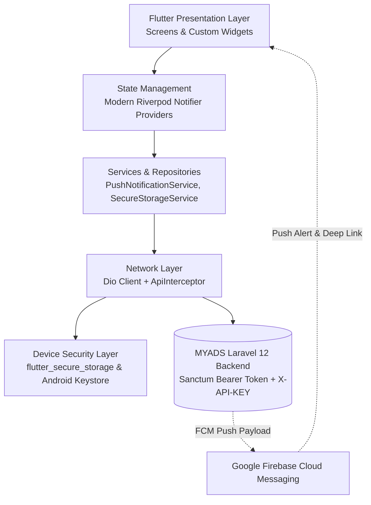

# MYADS Mobile App — Official Documentation & Wiki

Welcome to the comprehensive technical documentation and knowledge base for the **MYADS Flutter Mobile Client** (`myads_app`)!

> **Current Version:** 1.8.9+31 | **Target Platforms:** Android (API 23+) & iOS | **Framework:** Flutter 3.27+ (Dart 3.10+) | **Backend:** Laravel 12 REST API (Sanctum)

The MYADS Mobile App is an enterprise-grade social networking and digital advertising companion client built with Flutter. It connects seamlessly to the MYADS platform ecosystem, delivering native 60fps performance, hardware-accelerated security, short-form video clips with gesture navigation, a dedicated YouTube-style video hub, true threaded comments, real-time private messaging, an advanced notification center with FCM push delivery, and comprehensive multilingual RTL/LTR localization.

---

## 🧭 Documentation Directory

Explore the 8 core documentation categories below:

### 🚀 1. Overview & Architecture

| Guide | Page Link | Description |
| :--- | :--- | :--- |
| Documentation Portal Home | [Home](Home) | Main documentation portal, system overview, and tech stack summary. |
| Architecture & Design Patterns | [Architecture-and-Design-Patterns](Architecture-and-Design-Patterns) | Clean Architecture, modern Riverpod `Notifier` state management, and GoRouter declarative routing. |
| Project Structure & Directories | [Project-Structure-and-Directory-Guide](Project-Structure-and-Directory-Guide) | Complete layout of `lib/` modules, models, providers, services, and widgets. |

### ⚙️ 2. Getting Started & Setup

| Guide | Page Link | Description |
| :--- | :--- | :--- |
| Prerequisites & Environment Setup | [Prerequisites-and-Environment-Setup](Prerequisites-and-Environment-Setup) | Flutter SDK, Android SDK, JDK 17, and physical/emulator device setup. |
| Configuration & Environment Variables | [Configuration-and-Environment-Variables](Configuration-and-Environment-Variables) | Environment configuration (.env), BASE_URL, API keys, and FCM credentials. |
| Development Workflow & CLI Commands | [Development-Workflow-and-CLI-Commands](Development-Workflow-and-CLI-Commands) | Essential CLI workflows: `flutter pub get`, `gen-l10n`, `analyze`, and running targets. |

### 🛡️ 3. Network, API & Security

| Guide | Page Link | Description |
| :--- | :--- | :--- |
| API Client & Dio Networking | [API-Client-and-Dio-Networking](API-Client-and-Dio-Networking) | Dio HTTP singleton, request/response interceptors, and error handling. |
| Two-Layer Authentication & Sanctum | [Two-Layer-Authentication-and-Sanctum](Two-Layer-Authentication-and-Sanctum) | Dual security layer: platform `X-API-KEY` combined with Laravel Sanctum Bearer tokens. |
| Hardware-Encrypted Token Storage | [Hardware-Encrypted-Token-Storage](Hardware-Encrypted-Token-Storage) | Hardware-backed Android Keystore and iOS Keychain token storage via `flutter_secure_storage`. |
| Mobile Security & Hardening | [Mobile-Security-and-Hardening](Mobile-Security-and-Hardening) | Strict HTTPS enforcement, HTML injection sanitizer, and `SafeUrlLauncher`. |

### 🎬 4. Media, Video Hub & Clips

| Guide | Page Link | Description |
| :--- | :--- | :--- |
| Video Hub & Mobile Video Parity | [Video-Hub-and-Video-Parity](Video-Hub-and-Video-Parity) | Dedicated `/video` hub, Spotlight 16:9 hero video, category filter pills, and Shorts shelf. |
| Clips Short-Form Video System | [Clips-Short-Form-Video-System](Clips-Short-Form-Video-System) | Vertical 9:16 short-form video reel, swipe touch gestures, and audio sound discs. |
| Rich Multimedia Layouts & Audio | [Rich-Multimedia-Layouts-and-Audio](Rich-Multimedia-Layouts-and-Audio) | Adaptive photo grids, continuous audio players, and document attachment handlers. |

### 💬 5. Social Features & Messaging

| Guide | Page Link | Description |
| :--- | :--- | :--- |
| Community Feed & Expandable Posts | [Community-Feed-and-Expandable-Posts](Community-Feed-and-Expandable-Posts) | `PostCard` architecture, quote reposts, rich media embeds, and true threaded comments. |
| Member Profiles & Subscriber Tiers | [Member-Profiles-and-Subscriber-Tiers](Member-Profiles-and-Subscriber-Tiers) | Vikinger hexagonal avatars, VIP tier borders, bio stats, and verified badges. |
| Member ID Privacy & Anti-Enumeration | [Member-ID-Privacy-and-Anti-Enumeration](Member-ID-Privacy-and-Anti-Enumeration) | Anti-enumeration engine replacing numeric IDs with `public_uid` strings across routes. |
| Private Messaging & Real-Time Chat | [Private-Messaging-and-Real-Time-Chat](Private-Messaging-and-Real-Time-Chat) | 1-on-1 private messaging, chat bubbles, read status, and message attachments. |

### 🔔 6. Notifications & Background Services

| Guide | Page Link | Description |
| :--- | :--- | :--- |
| Firebase Push Notifications (FCM) | [Firebase-Push-Notifications-Guide](Firebase-Push-Notifications-Guide) | FCM HTTP v1 OAuth2 & Legacy push engine, background handlers, foreground banners, and deep linking. |
| In-App Notifications & Badge Counters | [In-App-Notifications-and-Badge-Counters](In-App-Notifications-and-Badge-Counters) | Modern notification center, category filter pills, swipe-to-delete, and reactive unread badges. |

### 🎨 7. Design System, Theming & i18n

| Guide | Page Link | Description |
| :--- | :--- | :--- |
| Design System & Material 3 Theming | [Design-System-and-Theming-Guide](Design-System-and-Theming-Guide) | Vikinger/Superdesign aesthetics, dark/light surface modes, and Google Fonts Outfit. |
| Localization & RTL Layouts | [Localization-and-RTL-Layouts](Localization-and-RTL-Layouts) | Bidirectional Arabic/English support, automated RTL mirroring, and .arb translation catalogs. |

### 📦 8. Store, Billing, Release & FAQ

| Guide | Page Link | Description |
| :--- | :--- | :--- |
| Digital Store, Orders & Billing | [Digital-Store-Orders-and-Billing](Digital-Store-Orders-and-Billing) | Digital scripts & templates marketplace, order tracking, and browser billing checkout. |
| Building, Signing & Release Guide | [Building-Signing-and-Release-Guide](Building-Signing-and-Release-Guide) | Keystore creation, Gradle release builds, ProGuard optimization, and Play Store AAB generation. |
| Troubleshooting, FAQ & Testing | [Troubleshooting-FAQ-and-Testing](Troubleshooting-FAQ-and-Testing) | Diagnostic solutions, common errors, automated unit/widget testing, and API verification. |

---

## 🏗️ System Architecture & Data Flow

---

## 🛠️ Technology Stack Summary

| Layer | Technologies & Dependencies | Purpose |
| :--- | :--- | :--- |
| **Framework** | Flutter 3.27+ / Dart 3.10+ | Cross-platform native mobile application engine |
| **State Management** | `flutter_riverpod: ^3.3.1` | Compile-safe reactive dependency injection & state management |
| **Networking** | `dio: ^5.9.2` | Advanced HTTP client with interceptors, retries, and headers |
| **Navigation** | `go_router: ^17.2.3` | Declarative URL-based deep linking and shell routing |
| **Push Notifications** | `firebase_messaging: ^16.4.3` | System push notifications, FCM tokens, and background events |
| **Local Storage** | `flutter_secure_storage: ^9.2.4` & `shared_preferences: ^2.5.5` | Hardware-encrypted token vault and user UI preferences |
| **Video Playback** | `video_player: ^2.9.6` & `chewie: ^1.10.0` | High-performance HTML5 and MP4 hardware-accelerated video rendering |
| **Audio Playback** | `just_audio: ^0.9.46` | Voice notes, audio posts, and background track streaming |
| **Typography & Icons** | `google_fonts: ^8.1.0` & `cupertino_icons: ^1.0.8` | Cross-platform typography (Outfit) and iconography |
| **Rich Content** | `flutter_html: ^3.0.0` & `flutter_markdown: ^0.7.7+1` | Structured BBCode, HTML, and Markdown content parsing |

---

## 💡 Key Highlights in Version 1.8.9+31

1. **Next-Gen Tier-1 Notification System:**
   - Multi-category filter pills (**الكل**, **الإشارات**, **التفاعلات**, **التعليقات**) with live unread count badges.
   - Rich Vikinger cards with sender `HexagonAvatar`, interaction badge overlays, bold username, and relative timestamps.
   - Interactive gestures including `Dismissible` swipe-to-delete and pull-to-refresh.
   - Real-time reactive unread count badge in `MyAdsScaffold` top bar.
2. **Complete Firebase Cloud Messaging (FCM) Integration:**
   - Dual-backend FCM HTTP v1 (OAuth2 JWT) and legacy server key support.
   - Top-level background message handlers (`firebaseMessagingBackgroundHandler`).
   - In-app floating foreground notification banners with one-tap deep-link navigation.
   - Automatic routing from cold-start and background taps directly into targeted screens (`/post?id=`, `/clips/:id`, etc.).
3. **Comprehensive Granular Settings:**
   - Independent control over Mobile Push notifications (Mentions, DMs, Followers, Comments, Likes) and Email notifications.
